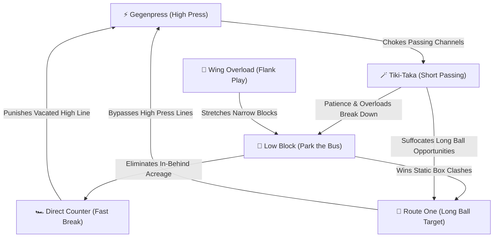
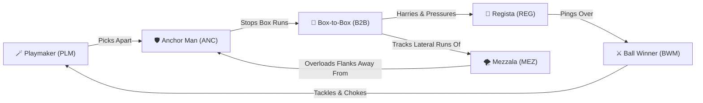

# ⚖️ Beyond The Final Whistle (BTFW) — Tactical Synergy & Counter Matrix

> **Core Balance Philosophy:** Every tactic and every playstyle has a natural predator and a natural prey. No single role, formation, or setting is universally overpowered. Victory requires reading your opponent's playbook and adapting.

---

## 🧭 The Grand Tactical Rock-Paper-Scissors

---

## 📊 Tactical Playbook: 6 Core Team Philosophies

| Tactical Philosophy | Ideal In-Game Settings (`-tactics`) | Thriving Playstyles (Synergies) | Prey (Tactics it Counters) | Predator (Hard-Countered By) |
| :--- | :--- | :--- | :--- | :--- |
| **🪄 Tiki-Taka / Control** | • Mentality: `Attacking` • Passing: `Short` • Focus: `Through Middle` • Press: `High` • Trap: `On` | • `F9` False Nine • `PLM` Playmaker • `BPD` Ball-Playing DC • `MEZ` Mezzala | **🧱 Low Block / Catenaccio** Breaks down defensive shells through rapid combinations and numerical overloads. | **⚡ Gegenpress & Blitz Counter** High-intensity physical pressing forces turnovers in dangerous midfield pockets. |
| **⚡ Gegenpress / High Hunt** | • Mentality: `Hard Attacking` • Passing: `Mixed` • Press: `High` • Tackling: `Hard` • Marking: `Man-to-Man` | • `PFW` Pressing Forward • `BWM` Ball Winner • `B2B` Box-to-Box • `COV` Covering Defender | **🪄 Tiki-Taka & Possession** Suffocates deep orchestrators (`REG`, `BPD`) before they can turn and pass. | **🎯 Route One** High balls simply fly over the pressing line directly to a physical Target Man. |
| **🏎️ Direct Counter-Attack** | • Mentality: `Defensive` • Passing: `Long` • Counter: `On` • Press: `Low` • Trap: `Off` | • `SPD` Speedster • `REG` Regista • `INF` Inside Forward • `NND` No-Nonsense DC | **⚡ Gegenpress & High Line** Capitalizes on 40 yards of green grass left behind reckless aggressive attackers. | **🧱 Low Block / Deep Shell** When the opposition refuses to push forward, pace in behind becomes useless. |
| **🦅 Wing Overload / Aerial** | • Mentality: `Attacking` • Passing: `Mixed` • Focus: `Down Both Flanks` • Marking: `Zonal` • Counter: `Off` | • `TGT` Target Man • `MEZ` Mezzala • `WCB` Wide Centre-Back • `INF` Inside Forward | **🧱 Narrow Central Shells** Bypasses congested central midfields by delivering continuous high crosses into the box. | **🛡️ Aerial Titans & Wide CBs** `AER` clears every cross; `WCB` smothers crossers before the ball can be whipped. |
| **🎯 Route One (Direct Target)** | • Mentality: `Normal` • Passing: `Long` • Focus: `Through Middle` • Counter: `On` • Press: `Low` | • `TGT` Target Man • `PCH` Poacher • `NND` Sweeper • `B2B` Box-to-Box | **⚡ Gegenpress** Refuses to engage in midfield duels; goalkeeper kicks directly to a muscular hold-up striker. | **🛑 Stoppers & Aerial Titans** `STP` and `AER` out-muscle target strikers and win first contact headers. |
| **🧱 Low Block / "Park the Bus"** | • Mentality: `Hard Defending` • Passing: `Mixed` • Press: `Low` • Marking: `Man-to-Man` • Trap: `Off` | • `ANC` Anchor Man • `STP` Stopper • `AER` Aerial Titan • `NND` No-Nonsense DC | **🏎️ Direct Speedsters & Counters** Dense bodies in the penalty box eliminate all running space for pure pace runners. | **🪄 Tiki-Taka & False Nines** Trickery, quick one-twos, and long-range rockets eventually pierce static defensive walls. |

---

## ⚔️ Playstyle Matchup Matrix (1v1 Natural Counters)

### 1. Strikers (ATT) vs Defenders (DEF)

```mermaid
classDiagram
    direction TB
    class Speedster {
        +SPD (Pace, Agility)
        Beats: Stopper, Ball-Playing DC
        Countered by: Covering DC, Sweeper
    }
    class TargetMan {
        +TGT (Strength, Heading)
        Beats: Covering DC, Wide CB
        Countered by: Aerial Titan, Stopper
    }
    class FalseNine {
        +F9 (Vision, Dribble)
        Beats: Sweeper, Stopper
        Countered by: Anchor Man, Ball-Playing DC
    }
    class Poacher {
        +PCH (Finishing, Composure)
        Beats: Zonal Defenders, Aerial Titans
        Countered by: Stopper, Man-to-Man Marker
    }
    class InsideForward {
        +INF (Cut inside, Pace)
        Beats: Traditional Central CBs
        Countered by: Wide Centre-Back (WCB)
    }
    class PressingForward {
        +PFW (Work Rate, Tackling)
        Beats: Ball-Playing DC (Forces Errors)
        Countered by: No-Nonsense Sweeper
    }
```

| Striker Archetype | Natural Victim (Wins Duel) | Why it Wins | Natural Counter (Loses Duel) | Why it Loses |
| :--- | :--- | :--- | :--- | :--- |
| **`SPD` Speedster** | `STP` Stopper, `BPD` Ball Playing DC | Exploits their lack of recovery acceleration with runs in behind. | `COV` Covering DC, `NND` Sweeper | They sit 5 yards deeper, anticipate through balls, and match top speed. |
| **`TGT` Target Man** | `COV` Covering DC, `WCB` Wide CB | Overpowers agile, slender defenders in physical shoulder charges and aerial duels. | `AER` Aerial Titan, `STP` Stopper | Titans match physical power and dominate contested headers in the 6-yard box. |
| **`F9` False Nine** | `NND` Sweeper, `STP` Stopper | Drags rigid center backs 20 yards out of position, leaving holes for wing runners. | `ANC` Anchor Man, `BPD` Ball-Playing DC | Anchor picks them up in the hole; BPD has the intelligence not to bite. |
| **`PCH` Poacher** | `AER` Aerial Titan, Zonal Setups | Slips behind tall, slow-turning defenders to score one-touch rebounds. | `STP` Stopper, Man-to-Man Marking | Physical stoppers shadow their every breath, blocking shooting angles. |
| **`INF` Inside Forward** | Narrow Central CBs | Cuts diagonally into half-spaces where center backs cannot track them without conceding space. | `WCB` Wide Centre-Back | Wide CBs specifically step into the half-space channel to intercept cutbacks. |
| **`PFW` Pressing Forward** | `BPD` Ball-Playing DC | Relentlessly harries creative ball-carriers, forcing panic turnovers inside their own box. | `NND` No-Nonsense DC | No-Nonsense defenders never dribble—they smash the ball into the stands instantly. |

---

### 2. Midfield Battle: Orchestrators, Engines & Destroyers

| Midfielder Archetype | Role in System | Dominates | Countered By |
| :--- | :--- | :--- | :--- |
| **`PLM` Playmaker** | Final-third creator (#10) | `ANC` Anchor Man (finds gaps behind), `STP` Stopper | `BWM` Ball Winner (physically harassed), High Pressing |
| **`BWM` Ball Winner** | Midfield destroyer & hunter | `PLM` Playmaker, `MEZ` Mezzala (crunching challenges) | `REG` Regista (moves ball before tackle lands), Short Passing |
| **`REG` Regista** | Deep-lying tempo conductor | `BWM` Ball Winner, Low Blocks (pin-point diagonals) | `PFW` Pressing Forward & `B2B` (harried with high stamina) |
| **`B2B` Box-to-Box** | All-action dynamic engine | `REG` Regista, `MEZ` Mezzala (out-works & out-runs) | `ANC` Anchor Man (walls off central box arrivals) |
| **`ANC` Anchor Man** | Holding defensive shield | `B2B` Box-to-Box, `F9` False Nine (walls central pocket) | `MEZ` Mezzala (drifts wide away from his central zone) |
| **`MEZ` Mezzala** | Half-winger flank overloader | `ANC` Anchor Man, `STP` Stopper (creates 2v1 overloads) | `WCB` Wide CB & `B2B` (tracks their wide lateral runs) |

---

### 3. Defenders (DEF): Strengths & Vulnerabilities

| Defender Archetype | Primary Specialty | Shuts Down | Vulnerable Against |
| :--- | :--- | :--- | :--- |
| **`NND` No-Nonsense DC** | Safety-first clearances & sweeping | `SPD` Speedster, Direct Counter-attacks | `F9` False Nine (drags them into unfamiliar midfield zones) |
| **`BPD` Ball-Playing DC** | Deep progressive distribution | Low Blocks (steps into midfield to create +1) | `PFW` Pressing Forward (punished if caught in possession) |
| **`STP` Stopper** | Aggressive forward tackling & containment | `PCH` Poacher, `TGT` Target Man | `SPD` Speedster (burned if they mistime their step-up) |
| **`COV` Covering Defender** | Paced recovery sweeps behind line | `SPD` Speedsters, Fast Over-the-Top Balls | `TGT` Target Man & `AER` (lacks size for brutal aerial duels) |
| **`AER` Aerial Titan** | 18-yard box aerial dominance | Crosses, `TGT` Target Man, Corners | Ground Tiki-Taka, `PCH` Poacher (slow turning radius) |
| **`WCB` Wide Centre-Back** | Wide channel containment | `INF` Inside Forward, `MEZ` Mezzala | Central Overloads (`PLM` + `PCH` through the middle) |

---

## 🏆 Key Golden Rules for Fair Play

1. **No "Meta" Exists in Isolation:** If a team stacks pure pace (`SPD` + `INF`), an opponent switching to `NND` Sweepers with `Defensive` mentality and `Trap Off` neutralizes their primary weapon.
2. **Tactical Flexibility Trumps Static Overall:** A 75 OVR squad employing the exact counter-tactic (e.g. `Route One` + `TGT` vs `Gegenpress`) can defeat an 82 OVR team caught in an unfavorable setup.
3. **Half-Time Adjustments Matter:** With BTFW's 3-minute halftime tactical window, team captains who identify that their opponent is playing a High Line can bring on a `Speedster` or toggle `Force Counter: ON` to turn the tide.
